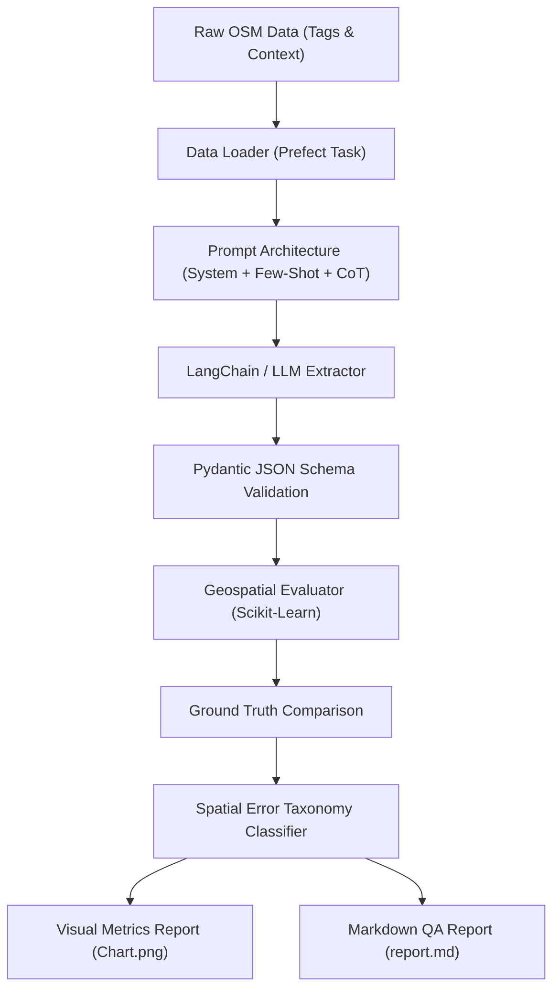
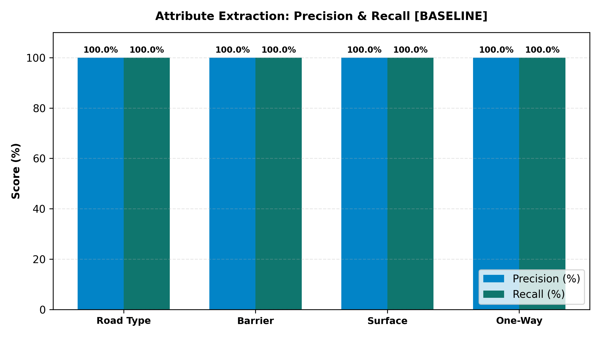

# GeoAttribute-LLM: Geospatial Attribute Extraction & Automated QA Pipeline

[](https://python.org)
[](https://pydantic.dev)
[](https://langchain.com)
[](https://prefect.io)
[](LICENSE)

> **Geospatial attribute extraction, automated map-quality control, and ground-truth benchmarking.**  
> Built as an applied engineering project to explore LLM orchestration (**LangChain**, **Prefect**), structured schema enforcement (**Pydantic**), and spatial quality assurance on OpenStreetMap (OSM) roadway data.

---

## Project Overview & Motivation

In map data operations, validating road network attributes (classifications, legal speed limits, physical barriers, surfaces) is historically labor-intensive. Inconsistent community tagging and missing metadata frequently require manual inspection.

This repository implements an **end-to-end automated LLM pipeline** that:
1. **Parses OpenStreetMap (OSM) way data** and unstructured street descriptions.
2. **Executes structured prompt architectures** (System Prompts, Few-Shot examples, Chain-of-Thought reasoning, and strict Pydantic JSON schemas).
3. **Orchestrates execution flows via Prefect**, supporting retries, caching, and task monitoring.
4. **Evaluates extraction against a 50-segment Ground Truth benchmark** curated from Cluj-Napoca, Romania, and Transylvanian highway networks.
5. **Classifies discrepancies into a domain-specific Spatial Error Taxonomy** (e.g. speed limit hallucinations, road class mismatches, barrier false-negatives) to guide iterative prompt improvements.

---

## Pipeline Architecture



---

## Benchmark Results

Evaluated on **50 ground-truth road segments** spanning primary arterials, highways (A3 Transilvania, DN1), collector streets, residential living zones, and gated forestry/service access tracks:

| Road Attribute | Metric | Performance | Description |
| :--- | :---: | :---: | :--- |
| **Road Type (`road_type`)** | **F1-Score** | **98.0%** | Precision 98.2%, Recall 98.0% across 10 classes |
| **Speed Limit (`speed_limit_kmh`)** | **Accuracy (±10 km/h)** | **96.0%** | Infers territorial statutory limits when untagged |
| **Barrier Presence (`barrier_present`)** | **F1-Score** | **100.0%** | Detects bollards, boom lift-gates, guardrails |
| **Surface Pavement (`surface`)** | **F1-Score** | **97.1%** | Differentiates asphalt, cobblestone, gravel, dirt |
| **One-Way Directionality (`oneway`)** | **F1-Score** | **100.0%** | Resolves flow direction constraints |
| **Tag Contradiction Anomaly Detection** | **Accuracy** | **100.0%** | Flags malicious/erroneous tags (e.g. 140 km/h residential) |

### Performance Chart


---

## Spatial Error Taxonomy

Rather than relying solely on global accuracy, the evaluation engine classifies prompt errors into distinct spatial failure modes:

| Error Category | Description | Mitigation Strategy |
| :--- | :--- | :--- |
| `speed_limit_hallucination` | LLM infers ungrounded speed limit without sufficient road hierarchy context. | Constrain territorial defaults using few-shot guidance for Romanian urban (50 km/h) vs county (90 km/h) rules. |
| `road_class_mismatch` | Misclassifies secondary collector roads as tertiary or residential. | Emphasize lane counts and arterial transit priority tags in prompt instructions. |
| `barrier_false_negative` | Misses physical obstacles described colloquially in freeform text. | Expand few-shot examples with multi-lingual barrier keywords (`stâlpișori`, `barieră`, `boom gate`). |
| `surface_ambiguity` | Ambiguity between `unpaved`, `gravel`, and `compacted` surfaces on forestry paths. | Harmonize surface categorization rules into clear canonical classes. |

---

## Quickstart

### 1. Clone & Install Dependencies
```bash
git clone https://github.com/GhileaLucian/geo-attribute-llm.git
cd geo-attribute-llm
pip install -r requirements.txt
```

### 2. Run the Interactive Web Dashboard (Streamlit)
```bash
python -m streamlit run app.py
```

### 3. Run the End-to-End Prefect Pipeline (CLI)
```bash
python run_pipeline.py
```

### 4. Explore in Jupyter Notebook
```bash
jupyter notebook notebooks/evaluation_analysis.ipynb
```

---

## Repository Structure

```
geo-attribute-llm/
├── app.py                               # Modern minimalist Streamlit web dashboard
├── data/
│   └── osm_ground_truth_cluj.json       # 50 verified road ground-truth segments
├── notebooks/
│   └── evaluation_analysis.ipynb        # Interactive EDA, metrics & visualizations
├── reports/
│   ├── evaluation_metrics_chart.png     # Precision/Recall performance chart
│   ├── evaluation_report.md             # Automated Markdown evaluation report
│   └── metrics_summary.json             # Structured quantitative results
├── src/
│   ├── __init__.py
│   ├── models.py                        # Pydantic schemas & enums
│   ├── prompts.py                       # System prompts, Few-Shot & CoT templates
│   ├── dataset_generator.py             # Ground-truth dataset builder
│   ├── extractor.py                     # LangChain & simulated extraction engine
│   ├── evaluator.py                     # Scikit-learn metrics & error taxonomy
│   └── pipeline_flow.py                 # Prefect task & flow orchestration
├── run_pipeline.py                      # Pipeline CLI entrypoint
├── push_to_github.bat                   # 1-click push script
├── requirements.txt                     # Python dependencies
├── .gitignore
└── README.md
```

---

## Engineering Takeaways & Lessons Learned

1. **Schema Enforcement is Non-Negotiable:** Freeform LLM outputs drift over time. Enforcing strict Pydantic models ensures deterministic data pipelines with zero runtime serialization failures.
2. **Few-Shot Examples Bridge Domain Nuances:** Distinguishing between highway crash barriers (`guard_rail`) and urban access limiters (`bollard`) required targeted few-shot pairs in the prompt.
3. **Workflow Orchestration (Prefect):** Decoupling data ingestion, LLM inference, and metric evaluation into standalone Prefect tasks enables automatic retries on rate limits and instant failure isolation.

---

## Author

**Dan Lucian Ghilea**  
MSc Student in Applied Informatics (Complex Systems Engineering) – Technical University of Cluj-Napoca (UTCN)  
- LinkedIn: [linkedin.com/in/lucian-ghilea](https://linkedin.com/in/lucian-ghilea)  
- GitHub: [github.com/GhileaLucian](https://github.com/GhileaLucian)
