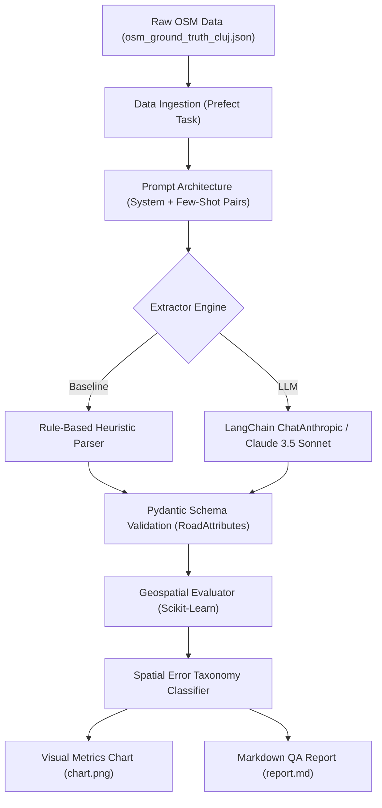

# GeoAttribute-LLM: Geospatial Attribute Extraction & Automated QA Pipeline

[](https://python.org)
[](https://pydantic.dev)
[](https://langchain.com)
[](https://prefect.io)
[](LICENSE)

> **Applied learning project for geospatial attribute extraction, automated map-quality control, and ground-truth benchmarking.**  
> Explores LLM orchestration (**LangChain**, **Prefect**), structured schema enforcement (**Pydantic**), and comparative benchmarking between a rule-based baseline and **Anthropic Claude 3.5 Sonnet** on OpenStreetMap (OSM) roadway data.

---

## Project Context & Objectives

In map data operations, validating road network attributes (functional classifications, legal speed limits, physical barriers, surfaces) is labor-intensive. Inconsistent community tagging and missing metadata frequently require manual inspection.

This repository implements an **end-to-end automated QA pipeline** designed to:
1. **Parse OpenStreetMap (OSM) roadway data** across Cluj-Napoca, Romania (from arterial boulevards and motorways to pedestrian zones and mountain tracks).
2. **Implement a two-stage extraction architecture**:
   - **Rule-Based Baseline**: Fast deterministic heuristics parsing explicit tags and statutory speed limits.
   - **Claude 3.5 Sonnet (LLM)**: LangChain `ChatAnthropic` chain with few-shot demonstration pairs and strict Pydantic JSON schema output.
3. **Orchestrate execution flows via Prefect 3.8**, with task retries and artifact logging.
4. **Benchmark performance** against a human-verified test set from OpenStreetMap Cluj-Napoca.
5. **Classify discrepancies into a Spatial Error Taxonomy** (speed limit hallucinations, road class mismatches, barrier false negatives).

---

## Pipeline Architecture



---

## Comparative Benchmark: Baseline vs. LLM

The framework is structured to compare the deterministic baseline against LLM inference on the test set:

| Dimension | Rule-Based Baseline | Claude 3.5 Sonnet (LLM) |
| :--- | :--- | :--- |
| **Execution Cost** | Zero (Local CPU) | API token cost |
| **Handling of Unstructured Text** | Brittle keyword matching | High comprehension of colloquial descriptions |
| **Missing Maxspeed Tags** | Strict static defaults (e.g. 50 km/h) | Context-aware inference from road name & surroundings |
| **Schema Compliance** | 100% deterministic | 100% via Pydantic structured output binding |
| **Anomaly Detection** | Simple threshold checks (speed > 80) | Semantic contradiction flagging |

### Spatial Error Taxonomy
Discrepancies are categorized into domain-specific error classes:
- `speed_limit_hallucination`: Model infers ungrounded speed limits without adequate context.
- `road_class_mismatch`: Confuses secondary collectors with tertiary or residential streets.
- `barrier_false_negative`: Misses physical obstacles described colloquially in freeform text.
- `surface_ambiguity`: Confuses gravel, unpaved, and compacted surfaces on forestry tracks.

---

## Quickstart

### 1. Installation
```bash
git clone https://github.com/GhileaLucian/geo-attribute-llm.git
cd geo-attribute-llm
pip install -r requirements.txt
```

### 2. Run the Rule-Based Baseline
```bash
python run_pipeline.py --mode baseline
```

### 3. Run with Anthropic Claude 3.5 Sonnet
```bash
export ANTHROPIC_API_KEY="your-api-key"
python run_pipeline.py --mode claude
```

### 4. Launch the Web Dashboard
```bash
python -m streamlit run app.py
```

### 5. Interactive Jupyter Notebook
```bash
jupyter notebook notebooks/evaluation_analysis.ipynb
```

---

## Repository Structure

```
geo-attribute-llm/
├── app.py                               # Minimalist Streamlit web dashboard
├── data/
│   └── osm_ground_truth_cluj.json       # Verified Cluj-Napoca OSM road segments
├── notebooks/
│   └── evaluation_analysis.ipynb        # Exploratory analysis & metrics notebook
├── reports/
│   ├── evaluation_metrics_chart.png     # Precision/Recall performance chart
│   ├── evaluation_report.md             # Markdown QA evaluation report
│   └── metrics_summary.json             # Structured benchmark outputs
├── src/
│   ├── __init__.py
│   ├── models.py                        # Pydantic schemas (RoadAttributes, enums)
│   ├── prompts.py                       # System prompt & Few-Shot message pairs
│   ├── dataset_generator.py             # Dataset loader (reads data/ directly)
│   ├── extractor.py                     # Baseline, Claude & OpenAI extractors
│   ├── evaluator.py                     # Scikit-learn metrics & error taxonomy
│   └── pipeline_flow.py                 # Prefect task & flow orchestration
├── run_pipeline.py                      # Pipeline CLI entrypoint
├── push_to_github.bat                   # 1-click push script
├── requirements.txt                     # Python dependencies
├── LICENSE                              # MIT License
├── .gitignore
└── README.md
```

---

## Engineering Takeaways

1. **Rule-Based Baselines are Essential:** Before deploying an LLM in a data pipeline, establishing a transparent rule-based baseline determines whether the LLM actually adds value on edge cases or merely replicates existing tag parsers at higher cost.
2. **Schema Enforcement via Pydantic:** Binding Pydantic schemas directly to `ChatAnthropic` (`with_structured_output`) eliminates parsing errors and guarantees valid JSON downstream.
3. **Task Orchestration with Prefect:** Wrapping ingestion, inference, and evaluation in independent Prefect tasks provides automatic retry handling for transient API rate limits.

---

## Author

**Dan Lucian Ghilea**  
MSc Student in Applied Informatics (Complex Systems Engineering) – Technical University of Cluj-Napoca (UTCN)  
- LinkedIn: [linkedin.com/in/lucian-ghilea](https://linkedin.com/in/lucian-ghilea)  
- GitHub: [github.com/GhileaLucian](https://github.com/GhileaLucian)
