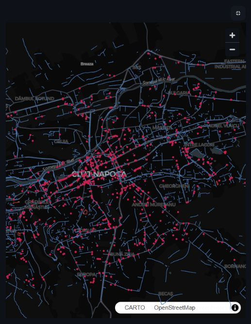

# GeoAttribute-LLM

A Python portfolio project for road-attribute extraction and map QA in Cluj-Napoca.
It analyzes 14,591 OSM road geometries and 849 barrier nodes.
Measured development result: local Qwen 3B **81.25%** exact match; rules **82.5%** (80 controlled texts).
Labels are OSM-derived, not independently verified field truth; no clear LLM advantage is claimed.
Claude/OpenAI quality benchmarking and human reference review remain pending.



Blue paths: displayed road geometries; red points: barrier nodes. The screenshot
shows 3,000 sampled ways; analysis includes all 14,591. Basemap © CARTO,
© OpenStreetMap contributors. A connected barrier does not automatically mean a blocked road.

## Run without an API key

```powershell
python -m pip install -r requirements.txt
python -m streamlit run app.py
```

Open the **Map QA & ML** tab. Reports are included; no model call occurs when
changing map filters. To rebuild the offline analysis and notebook:

```powershell
python run_mapqa.py all --mode rules --cached-only
python -m pytest -q
```

## What this demonstrates

- Prompt iteration, LangChain/ChatOllama, explicit JSON Schema and Pydantic validation.
- Precision, recall, F1, error examples and a separately reported hybrid rule guard.
- Metric GIS checks, a Prefect flow with a successful scheduled smoke test, and an executed Jupyter notebook.
- Exploratory classification, regression and clustering—not production map models.

## Results in context

Requiring every output field changed development exact match from **2.5% (v5)**
to **81.25% (v6)**. Both the prompt and schema changed; this is not a prompt-only experiment.
The 15 fictional hard cases are development/regression fixtures, not an independent test.
The final 40-record controlled-text sample scored 90% vs 87.5% for rules—one record.
It contains no numeric speed references and only positive barrier examples.

The [new review protocol](docs/BENCHMARK_REVIEW_RO.md) requires human-written/reviewed
labels, mixed coverage and a frozen baseline before a new benchmark can run.
No new benchmark is evaluated until that review is complete.

## Inspect the evidence

- [Methods, limitations and commands](docs/MAP_QA_RO.md)
- [Executed notebook](notebooks/map_quality_analysis.ipynb)
- [Saved benchmark reports](reports/mapqa/benchmarks)
- [Interview preparation](docs/INTERVIEW_RO.md)
- [Geographic hold-out and coordinate ablation](docs/SPATIAL_ML_AUDIT_RO.md)
- [Previous experiments and full archived README](docs/EXPERIMENT_HISTORY.md)

OSM-derived data: [OpenStreetMap contributors, ODbL](https://www.openstreetmap.org/copyright).
MIT covers code only. Do not publish API keys, `.env` or model weights.
